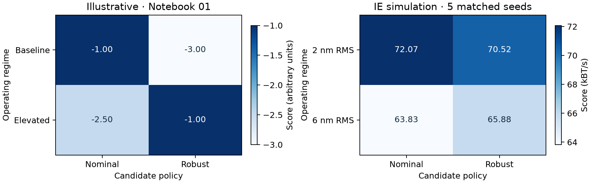
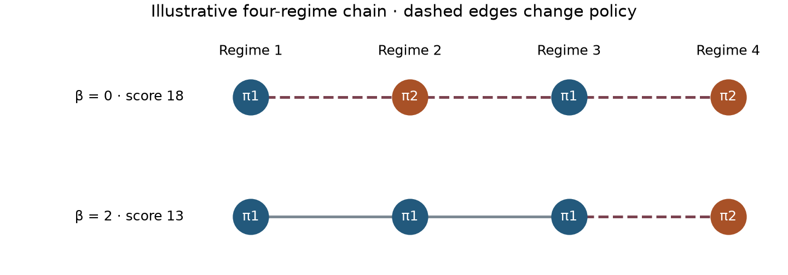

# Q-SYNTH synthesis and validation workflow

The feedback loop estimates the physical state and commands the actuator at the control rate. Offline synthesis evaluates choices for that loop and returns a lookup table. In intended hardware, the fast controller remains classical and may run on an FPGA.

**IE model or experiment → fixed-policy simulations → local matrix → global objective → classical or quantum synthesis → policy map → IE validation**

| Stage | Input → output | Check |
|---|---|---|
| IE model or experiment | Physical model, measurements and operating conditions → named regimes and candidate policies | Confirm what changes between regimes and which parameters a policy fixes. |
| Fixed-policy simulations | One regime and one policy → repeated stochastic runs | Disable supervisor switching and pair seeds across policies. |
| Local performance matrix | Trial objectives → mean \(J_{ij}\) and uncertainty | Rows are regimes and columns are policies. Use the same score definition and units throughout this instance. |
| Global policy-map objective | Local matrix, regime graph and coupling cost → score for a complete map | The graph and pairwise mismatch costs are separate from the matrix. |
| Classical or quantum synthesis | Global objective → a candidate map \(\Pi\) | Compare both methods on the same instance and decode only valid maps. |
| IE validation | Deploy the candidate map in the simulator → observed performance under held-out scenarios | Compare with the classical baseline. Check switching behavior, sensitivity and control constraints. |

\[
S(\Pi)=\sum_i J_{i,\Pi(i)}-\lambda\sum_{(i,k)\in E}C(\Pi(i),\Pi(k)).
\]

Here \(E\) identifies the interacting regimes, \(C\) gives the pairwise policy mismatch, and \(\lambda\) is the switching weight called \(\beta\) in the coupled notebooks. Setting the weight to zero gives independent row-wise selection. With nonzero coupling, the best choice in one regime may depend on its neighbors.



*Left: illustrative scores used for the early teaching notebooks. Right: IE-derived mean performance from five matched seeds, in \(k_BT/\mathrm{s}\). Each panel has its own color scale. The IE batch stores cost, so the plotted performance is its negative.*



*These are two exact solutions of the illustrative four-regime chain, with switching weights 0 and 2. Node labels show the selected policy. Dashed edges indicate where it changes. This example uses a different local matrix from either heatmap.*

## Quantum branch

\[
(J,E,C,\lambda)\ \rightarrow\ \text{QUBO}\ \rightarrow\ \text{Ising}\ \rightarrow\ \text{QAOA}\ \rightarrow\ \text{transpilation}\ \rightarrow\ \text{noisy simulation}\ \rightarrow\ \text{QPU}.
\]

1. Encode the policy constraints and the negative of the global score as a binary energy. Check feasible energies against exact enumeration on the teaching instance.
2. Convert bits to Pauli \(Z\) eigenvalues. Verify that QUBO and Ising energies agree after accounting for the constant offset.
3. Tune the QAOA circuit and sample it. Report feasibility, optimal frequency, and mean score alongside the best observed map.
4. Compile to a specific topology and native basis. For a fair comparison, simulate the same native circuit both with and without a noise model, using a layout-aware decoder.
5. For a future QPU execution, record the actual target, calibration metadata, transpiled circuit, shots and job identity. Decode the selected map and take it back to IE validation.

The current coupled hardware benchmark uses illustrative scores, a synthetic target and modeled noise. A held-out IE replay remains necessary to validate an application policy map.

## Reproduce this step

Follow the [notebook sequence](notebook-sequence.md). To rebuild the figures, run the offline IE sweep from the repository root and pass its emitted JSON to the plotting example.

```text
python ie/run_synthesis_offline.py
python examples/01_seminar_figures.py ie/results/runs/offline_<batch-id>/instance.json
```

Replace the batch placeholder with the actual run directory. The command writes the two PNGs to `docs/assets`.
